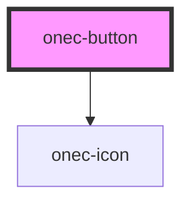

# onec-button

<!-- Auto Generated Below -->

## Overview

Déclenche une action dans la page : envoyer un formulaire, ouvrir une fenêtre, confirmer un choix.
Contrat : `docs/contracts/button.md`.

## Properties

| Property   | Attribute  | Description                                                              | Type                                                                                   | Default       |
| ---------- | ---------- | ------------------------------------------------------------------------ | -------------------------------------------------------------------------------------- | ------------- |
| `color`    | `color`    | Rôle de couleur. `primary` et `secondary` suivent la marque.             | `"error" \| "info" \| "neutral" \| "primary" \| "secondary" \| "success" \| "warning"` | `'primary'`   |
| `disabled` | `disabled` | Désactive le bouton et le retire de la tabulation.                       | `boolean`                                                                              | `false`       |
| `loading`  | `loading`  | Action en cours : le bouton n'est plus activable mais reste focalisable. | `boolean`                                                                              | `false`       |
| `name`     | `name`     | Nom envoyé avec le formulaire quand ce bouton le soumet.                 | `string`                                                                               | `undefined`   |
| `size`     | `size`     | Taille : 32, 40 ou 48 px de haut.                                        | `"large" \| "medium" \| "small"`                                                       | `'medium'`    |
| `type`     | `type`     | Comportement dans un formulaire.                                         | `"button" \| "reset" \| "submit"`                                                      | `'button'`    |
| `value`    | `value`    | Valeur envoyée avec le formulaire quand ce bouton le soumet.             | `string`                                                                               | `undefined`   |
| `variant`  | `variant`  | Niveau d'emphase.                                                        | `"contained" \| "ghost" \| "outlined"`                                                 | `'contained'` |

## Slots

| Slot           | Description                         |
| -------------- | ----------------------------------- |
|                | Le libellé, en texte. Obligatoire.  |
| `"icon-end"`   | Une `<onec-icon>` après le libellé. |
| `"icon-start"` | Une `<onec-icon>` avant le libellé. |

## Shadow Parts

| Part           | Description                                                  |
| -------------- | ------------------------------------------------------------ |
| `"base"`       | Le `<button>` natif : fond, bordure, rayon, anneau de focus. |
| `"icon-end"`   | Le conteneur de l'icône de fin.                              |
| `"icon-start"` | Le conteneur de l'icône de début.                            |
| `"label"`      | Le conteneur du libellé.                                     |
| `"spinner"`    | L'indicateur de chargement.                                  |

## Dependencies

### Depends on

- [onec-icon](../onec-icon)

### Graph

----------------------------------------------

